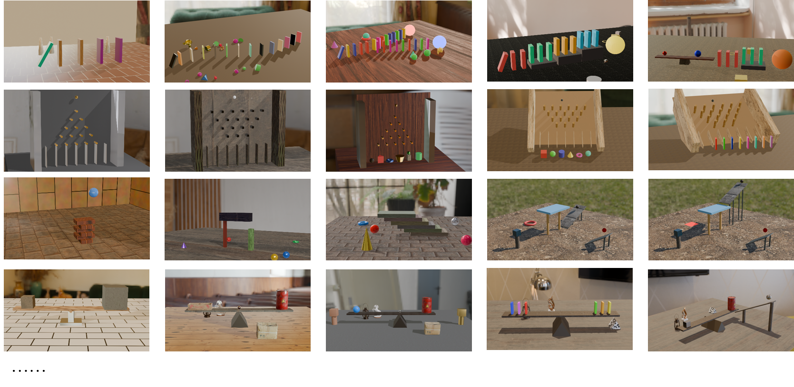
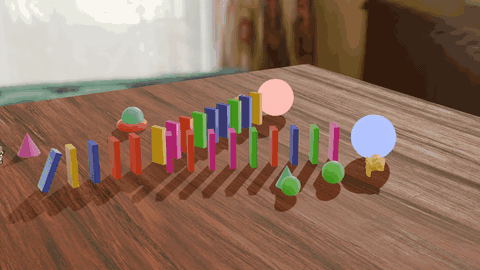
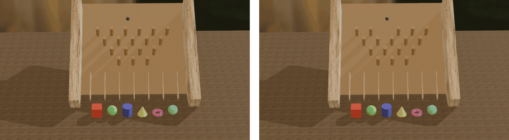
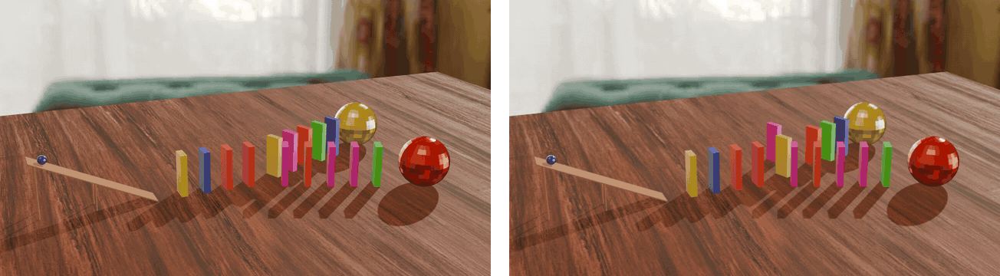
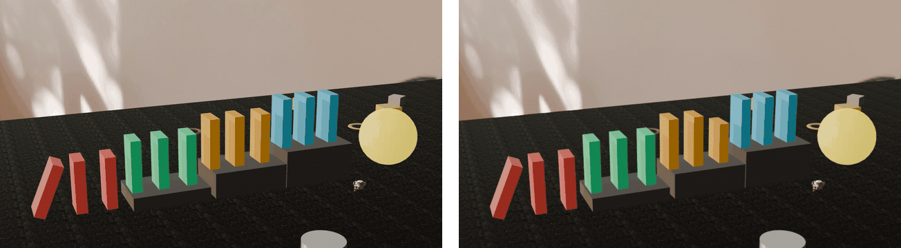
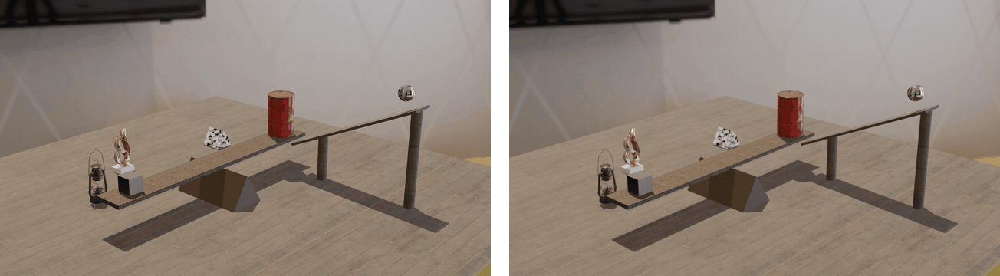
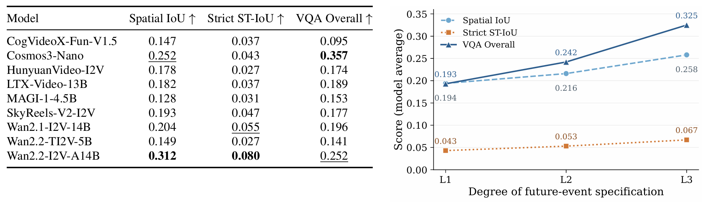
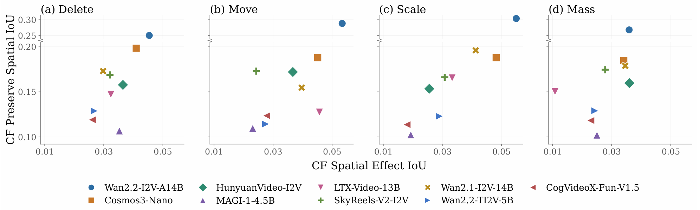

# CausalCascade

[](https://arxiv.org/abs/2610.15562)
[](https://huggingface.co/datasets/deepdeltalab/CausalCascade)
[](https://github.com/SJTU-DeepDeltaLab/CausalCascade)

**CausalCascade** is a simulator-grounded benchmark for *causal cascade generation* in image-to-video models: generating a complete physical process from an initiating event through dependent interactions to a terminal outcome.

## Dataset Overview

### Scene Diversity



### Three Levels of Future-Event Specification

The same initial frame and reference rollout are paired with three textual conditions: **state-only** (describes the current scene state and relevant physical conditions), **trigger-aware** (additionally specifies the initiating event), and **full event-chain** (verbalizes the major event chain). 

<details>
<summary>View example: Y-shaped domino cascade</summary>



<details>
<summary>Show the three prompt levels</summary>

**Level 1: State-only**

```text
Generate a physically realistic continuation video by predicting the subsequent physical evolution from the given fixed-camera first frame.

Important instructions:
- Preserve the fixed camera view.
- The first frame is authoritative for all visible geometry, object sizes, initial poses, contact relations, spatial layout, and camera view.
- Treat only the listed dynamic active objects and dynamic active object groups as freely moving rigid bodies.
- Treat anchored static colliders as fixed to the world.

Global rigid-body convention:
- All rigid bodies use friction = 0.50, restitution = 0.10, linear damping = 0.04, angular damping = 0.10.
- For every rigid body, the geometric center is also its center of mass.

Dynamic active objects:
- upper branch target sphere: the large target sphere at the upper/right end of the fork. Mass = 1.0 kg.
- lower branch target sphere: the large target sphere at the lower/right end of the fork. Mass = 1.0 kg.

Dynamic active object groups:
- central stem domino row: the five upright dominoes forming the straight stem before the fork splits. This group contains 5 dominoes. Each object has mass = 1.0 kg.
- upper fork domino branch: the upper row of upright dominoes after the split. This group contains 9 dominoes. Each object has mass = 1.0 kg.
- lower fork domino branch: the lower row of upright dominoes after the split. This group contains 9 dominoes. Each object has mass = 1.0 kg.

Anchored static objects:
- wooden tabletop surface: the broad surface beneath the forked domino structure.

Decorative context:
- The remaining objects are anchored static decorators and should remain visually unchanged.
```

**Level 2: Trigger-aware**

```text
Generate a physically realistic continuation video by predicting the subsequent physical evolution from the given fixed-camera first frame.

Trigger event: The first tilted blue domino at the left start of the fork falls into the next domino.

Important instructions:
- Preserve the fixed camera view.
- The first frame is authoritative for all visible geometry, object sizes, initial poses, contact relations, spatial layout, and camera view.
- Treat only the listed dynamic active objects and dynamic active object groups as freely moving rigid bodies.
- Treat anchored static colliders as fixed to the world.

Global rigid-body convention:
- All rigid bodies use friction = 0.50, restitution = 0.10, linear damping = 0.04, angular damping = 0.10.
- For every rigid body, the geometric center is also its center of mass.

Dynamic active objects:
- upper branch target sphere: the large target sphere at the upper/right end of the fork. Mass = 1.0 kg.
- lower branch target sphere: the large target sphere at the lower/right end of the fork. Mass = 1.0 kg.

Dynamic active object groups:
- central stem domino row: the five upright dominoes forming the straight stem before the fork splits. This group contains 5 dominoes. Each object has mass = 1.0 kg.
- upper fork domino branch: the upper row of upright dominoes after the split. This group contains 9 dominoes. Each object has mass = 1.0 kg.
- lower fork domino branch: the lower row of upright dominoes after the split. This group contains 9 dominoes. Each object has mass = 1.0 kg.

Anchored static objects:
- wooden tabletop surface: the broad surface beneath the forked domino structure.

Decorative context:
- The remaining objects are anchored static decorators and should remain visually unchanged.
```

**Level 3: Full event-chain**

```text
A curved, slightly branching line of brightly colored domino blocks stands upright across the middle of a wooden tabletop, with a small purple cone at the far left, a small red-and-teal rounded piece behind the dominoes, several little green and brown peg-like toys in front, a large pink ball near the back-right end, and a large light-blue ball near the front-right end. The motion starts at the left end when the first domino tips and hits the next, launching a chain reaction that travels steadily from left to right through the whole arrangement. Each block knocks its neighbor over, and the collapse passes through the center and then fans through the angled right-side branches, so the dominoes slap down in sequence and spread into overlapping lines on the table. As the final rightmost blocks fall, they nudge the two large balls, making the pink ball roll slightly farther back and right and the blue ball roll rightward away from the domino pile. By the end, all of the dominoes lie flat in a scattered fan-shaped heap across the center, the two balls have shifted to the right, and the smaller cone and peg-like pieces remain standing around the wreckage. Keep the camera fixed.
```

</details>

</details>

### Factual–Counterfactual Pairs

Each edit applies a single-object **delete**, **move**, **scale**, or **mass** intervention and provides separately simulated factual and counterfactual references with matched Level 1 prompts.

<details>
<summary>View delete intervention case</summary>



**Description:** Remove the third peg from the left in the top row of the Galton board.

</details>

<details>
<summary>View move intervention case</summary>



**Description:** Move the first pink domino on the upper branch of the Y-shaped chain toward the upper left.

</details>

<details>
<summary>View scale intervention case</summary>



**Description:** Reduce the height of the rightmost yellow domino on the middle step.

</details>

<details>
<summary>View mass intervention case</summary>



**Description:** Increase the mass of the barrel.

</details>

## Results

### Causal Cascade Fidelity



**Left**: Performance of current I2V models under the Level 1 prompt.
**Right**: Model-average performance as future-event specification becomes more explicit.

### Selective Causal Responsiveness



**Counterfactual motion response across intervention types. Each marker denotes one I2V model.** Higher values on both axes indicate stronger selective causal responsiveness.

## Quick Start

Use Python 3.10+.

```bash
pip install -e ".[data,metrics,video]"
python -m causalcascade.prepare_dataset --output-dir data
```

See [USAGE.md](USAGE.md) for input layouts, motion and counterfactual evaluation, outputs, and generation adapters. See [VQA.md](VQA.md) for automated diagnostic VQA.

## License

Code: [MIT](LICENSE). Dataset: [CC BY 4.0](https://huggingface.co/datasets/deepdeltalab/CausalCascade). Third-party models and dependencies retain their own licenses.

## Citation

If you use CausalCascade in your research, please cite:

```bibtex
@misc{causalcascade,
      title={A Plausible Future Is Not a Causal Future: Can Video Models Generate How the World Unfolds?},
      author={Jialiang Li and Zhengning Xu and Zongyang Ma and Shaobo Cui},
      year={2026},
      eprint={2610.15562},
      archivePrefix={arXiv},
      primaryClass={cs.CV},
      url={https://arxiv.org/abs/2610.15562},
}
```

